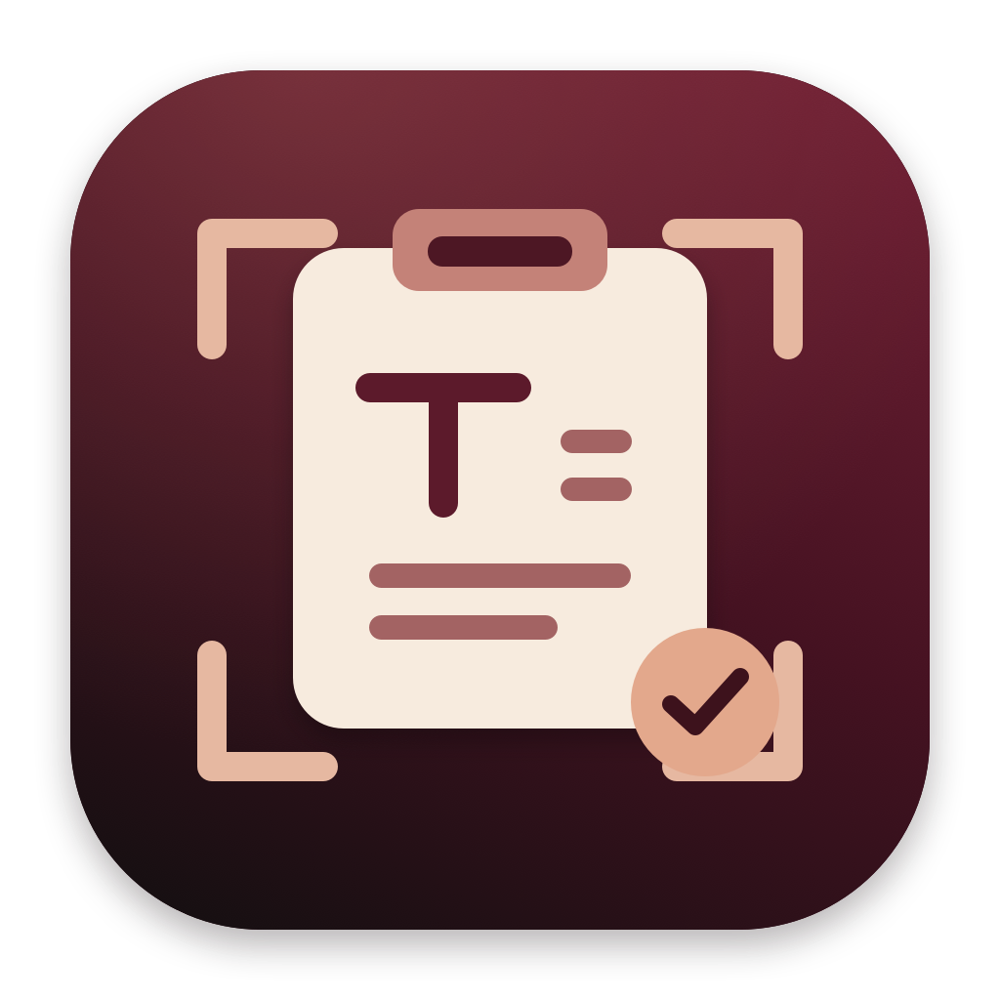

<p align="center">
  
</p>
<h1 align="center">ClipOCR</h1>
<p align="center"><strong>Screenshot text. Paste anywhere.</strong><br>A tiny, private, native macOS menu-bar utility.</p>
<p align="center">
  <a href="https://github.com/otron-io/clipocr/actions/workflows/ci.yml"></a>
  <a href="https://github.com/otron-io/clipocr/releases/latest"></a>
  
  
  <a href="LICENSE"></a>
</p>
<p align="center"><a href="https://github.com/otron-io/clipocr/releases/latest"><strong>Download for Mac →</strong></a></p>

---

**⌘⇧6 → drag a box around text → paste with ⌘V.**

ClipOCR uses **Apple Vision** to recognize text entirely on your Mac. No upload, account, API key, subscription, or internet connection. No result window to dismiss: the text goes straight to your clipboard.

## Features

- **One global shortcut:** Command–Shift–6, from any app.
- **Native region selection:** the familiar macOS screenshot crosshair; Escape cancels.
- **On-device OCR:** Apple Vision's accurate mode and automatic language detection.
- **Automatic clipboard copy:** a menu-bar checkmark and quiet sound indicate success.
- **No spelling correction:** avoids deliberately rewriting code, identifiers, or unusual words.
- **Lightweight:** native Swift/AppKit, no Electron, third-party packages, or cloud client.
- **Private by design:** temporary screenshots are cleaned up, with no screenshot history.
- **Optional launch at login:** opt in from the menu; disabled by default.

## Mac compatibility

| Requirement | Support |
| --- | --- |
| Operating system | **macOS 13 Ventura or later** |
| Apple Silicon | **Yes** — arm64 slice included |
| Intel | **Yes** — x86_64 slice included; Mac must support macOS 13+ |
| Distribution | **Universal app** — one download for both architectures |
| Apple Intelligence | **Not required** |
| Foundation Models | **Not required** — Vision is the image-to-text framework |
| Internet / subscription | **Not required** |
| Screen Recording permission | **Required** for region capture |
| Accessibility permission | **Not required** |

The deployment target is macOS 13, covering Ventura, Sonoma, Sequoia, Tahoe, and compatible later versions. Local OCR/runtime tests were run on Apple Silicon with macOS 26 Tahoe. Both slices are cross-built with a macOS 13 minimum; that is **not** a claim that every older OS version or Intel model has been runtime-tested. CI tests run on GitHub's macOS 15 runner; see [Actions](https://github.com/otron-io/clipocr/actions) for actual results.

## Download and install

1. Open the [latest release](https://github.com/otron-io/clipocr/releases/latest).
2. Download **`ClipOCR-<version>-universal.dmg`**.
3. Open the DMG and drag **ClipOCR.app** onto **Applications**.
4. Eject the DMG and open ClipOCR from Applications.
5. Look for the **text viewfinder icon in your menu bar**. There is no Dock icon or main window.

A ZIP of the same universal app is available if you prefer not to use a DMG. `SHA256SUMS.txt` is included with each release.

### First open: Gatekeeper

**These releases are ad-hoc signed, not Apple Developer ID-signed or Apple-notarized.** macOS may block the first launch.

- On macOS 13/14, control-click the app and choose **Open**, then confirm if offered.
- On newer macOS, attempt to open the app, then go to **System Settings → Privacy & Security → Open Anyway** and follow the prompts.

Only approve the app you obtained from [this repository's releases](https://github.com/otron-io/clipocr/releases). You do **not** need to disable Gatekeeper globally. Managed/work Macs may prevent running non-notarized apps; follow your organization's policy.

### First capture: Screen Recording

1. Press **⌘⇧6**.
2. Allow ClipOCR in **System Settings → Privacy & Security → Screen & System Audio Recording** (named **Screen Recording** on older macOS).
3. Quit and reopen ClipOCR if macOS requests it, then retry the shortcut.
4. Drag a rectangle around your text and release the mouse.
5. When the menu-bar icon becomes a checkmark, **⌘V** pastes the text.

Screen Recording is macOS's permission name even though ClipOCR only captures the region you explicitly select. The app's menu has a shortcut to the permission settings.

## Everyday use

| Action | Result |
| --- | --- |
| **⌘⇧6** | Start a region selection |
| Drag and release | Recognize the selected text and copy it automatically |
| **Escape** during selection | Cancel; leave the clipboard unchanged |
| **⌘V** in another app | Paste the recognized text |
| Menu → **Capture Text** | Start capture without the global shortcut |
| Menu → **Launch at Login** | Enable or disable automatic startup |
| Menu → **Show Last Error…** | Read the latest actionable error |
| Menu → **Quit ClipOCR** | Stop the utility and cancel any pending capture |

The menu shows the last recognized character count and OCR time. Requests run one at a time. Recognition errors, blank selections, and cancellation leave the existing clipboard unchanged. Selections are limited to 20 MB / 64 megapixels, and the screenshot selector times out after five minutes.

## Accuracy and languages

Apple Vision recognizes supported languages automatically, using the recognition capabilities bundled with macOS. Language/script support can differ by OS version; ClipOCR does not claim to recognize every language.

Detected lines are arranged top-to-bottom and left-to-right. Indentation and large paragraph gaps are estimated from image geometry. A screenshot cannot encode whether whitespace was tabs or spaces, and complex multi-column layouts may not paste in the order you expect.

Small text, unusual fonts, blur, low contrast, and ambiguous characters can cause OCR errors. Select a clear, tightly cropped region and review important text before relying on it. There is no language model that rewrites or "fixes" the result.

## Privacy

- **Nothing is uploaded.** Recognition runs locally through Apple's Vision framework.
- **No telemetry, cloud SDK, or model download by ClipOCR.** The app works offline.
- Captures use a private `0700` directory under `~/Library/Caches/io.otron.clipocr/Requests/`.
- Screenshots and subprocess logs are deleted after success, failure, cancellation, and graceful quit. Leftovers from a crash are removed at the next startup.
- Text goes to the normal macOS clipboard. Universal Clipboard and clipboard-manager behavior follow your existing system/app settings.
- Source and release assets contain no user screenshots or OCR history.

## Troubleshooting

### The shortcut does nothing

Check that ClipOCR is running in the menu bar. Some Macs reserve **⌘⇧6** for Touch Bar screenshots, and another utility may also use it. Disable the conflicting assignment under **System Settings → Keyboard → Keyboard Shortcuts → Screenshots**, then relaunch ClipOCR. ClipOCR does not silently change your system shortcuts. **Capture Text** from its menu remains available if registration failed.

### macOS won't open the app

See [Gatekeeper](#first-open-gatekeeper). Move the app out of the DMG before opening it. A non-notarized release may be disallowed by managed-device policies.

### Capture is blocked or permission keeps appearing

Enable ClipOCR in Screen Recording settings, quit it, and reopen it from its installed location. Avoid keeping multiple copies running from different locations. If you switch installation paths or replace a build, macOS may ask for permission again.

### No text was copied

Check **Show Last Error…**. A blank or unreadable selection does not overwrite your clipboard. Try a smaller, clearer crop. The menu-bar checkmark is the success signal; a viewfinder means capture is idle, an ellipsis means OCR is running, and an exclamation mark means an error.

## Build from source

You need **Xcode 15+ / Swift 5.9+** and a macOS SDK. Release packaging uses `hdiutil`, `iconutil`, `sips`, `codesign`, and `lipo`, all supplied with macOS/Xcode tooling. The checksum script also uses `python3`.

```sh
git clone https://github.com/otron-io/clipocr.git
cd clipocr
swift test
bash scripts/build.sh
open dist/ClipOCR.app
```

`build.sh` builds **both architectures** with a macOS 13 deployment target, creates `dist/ClipOCR.app`, copies the icon, and ad-hoc signs it. To build one architecture instead:

```sh
CLIPOCR_ARCH=arm64 bash scripts/build.sh
# or: CLIPOCR_ARCH=x86_64 bash scripts/build.sh
```

To install your source build under your own user account:

```sh
bash scripts/install.sh
open "$HOME/Applications/ClipOCR.app"
```

Quit ClipOCR before reinstalling. The installer refuses to overwrite an unrelated app and keeps the bundle ID `io.otron.clipocr` stable.

### Tests and CLI mode

```sh
swift build
swift test
.build/debug/ClipOCR --recognize-image /path/to/image.png
```

CLI mode prints JSON containing `text` and `seconds`; it does **not** capture your screen or modify your clipboard. Errors return a nonzero exit.

Tests cover real Apple Vision recognition on generated single-line/multiline/blank images, text layout, private workspaces, cleanup, subprocess errors, large output, timeouts, and cancellation. They do not capture the screen or touch the clipboard. Set `CLIPOCR_TEST_ROOT` to choose where temporary test files go.

### Icons and release packaging

The burgundy/charcoal icon is original artwork, reproducibly rendered with AppKit:

```sh
bash scripts/make-icon.sh
bash scripts/package-dmg.sh
```

Packaging builds a universal app and emits these files in `dist/`:

- `ClipOCR-<version>-universal.dmg`
- `ClipOCR-<version>-universal.zip`
- `SHA256SUMS.txt`

Existing release files are not silently overwritten. The DMG contains the app, an Applications shortcut, first-run instructions, and the MIT license. Check downloaded assets with:

```sh
shasum -a 256 -c SHA256SUMS.txt
```

For maintainers: update `Resources/Info.plist` and `CHANGELOG.md`, commit, and push a matching `vX.Y.Z` tag. The [release workflow](.github/workflows/release.yml) runs tests, packages both architectures, and publishes the DMG, ZIP, and checksums. It refuses a tag/version mismatch. No Developer ID certificate or signing secret is configured.

## Uninstall

Disable **Launch at Login** from ClipOCR's menu if enabled, quit it, and remove the installed `ClipOCR.app`. Optionally remove `~/Library/Caches/io.otron.clipocr` and revoke its Screen Recording permission in System Settings. For a source install, the app is under `~/Applications` rather than `/Applications`.

## Contributing

Bug reports and focused pull requests are welcome. Include your macOS version, CPU architecture, what you expected, and what happened. Use a synthetic example when possible; **do not upload private screenshots, credentials, or clipboard contents** to public issues.

## License

[MIT](LICENSE) · Copyright © 2026 Otron.io.
